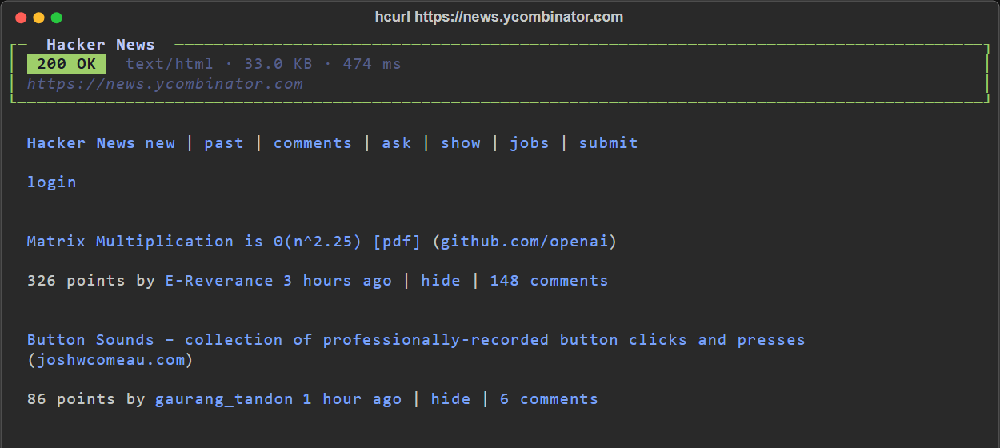
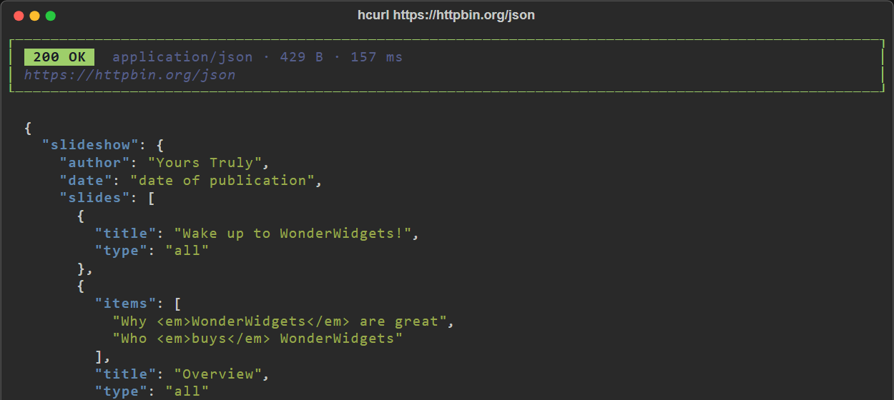
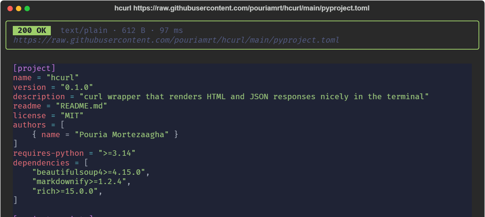

# hcurl

**curl for humans reading in a terminal.** `hcurl` runs the real `curl` with your arguments, then shows HTML pages as readable text, JSON as colored, indented data and code (CSS, JS, XML, YAML, source files) with syntax highlighting, with a status card on top.







## Install

Requires Python 3.14+, [uv](https://docs.astral.sh/uv/) and `curl` on your PATH.

```bash
uv tool install git+https://github.com/pouriamrt/hcurl
```

## Usage

Use it exactly like curl. Every flag is passed through unchanged.

```bash
hcurl https://news.ycombinator.com             # HTML page, rendered as text
hcurl https://httpbin.org/json                 # JSON, pretty-printed
hcurl https://raw.githubusercontent.com/pouriamrt/hcurl/main/pyproject.toml  # highlighted
hcurl -X POST -d name=ada https://httpbin.org/post
hcurl -H "Authorization: Bearer $TOKEN" https://api.example.com/me
curl -s https://example.com | hcurl -          # render a body you already have
```

## What you get

- **Status card:** page title, a status badge colored by class (2xx green, 3xx amber, 4xx/5xx red), content type, size, response time and URL.
- **HTML:** headings, lists, tables, links and code blocks, drawn by [rich](https://github.com/Textualize/rich). Scripts, styles, images and forms are dropped. Header-less layout tables (the way older sites like Hacker News lay out pages) are flattened into plain blocks.
- **JSON:** indented and colored. A body labelled JSON that doesn't parse is printed as-is instead of crashing.
- **Code and config:** CSS, JavaScript, XML, YAML, TOML and other text bodies are syntax highlighted. The language comes from `Content-Type` first, then the URL's file extension (so a `.py` file served as `text/plain` is still highlighted). Bodies over 64 KB print raw, since highlighting them takes seconds.
- **Progress:** a spinner shows the URL while curl runs and disappears when the response arrives. curl's error messages print after it, unchanged. It is skipped when curl may need the terminal: a password prompt (`-u name` with no `:password`), a client key passphrase (`-E`/`--key` without `--pass`), or a body read from the keyboard (`-d @-`, `-T -`).
- **Everything else:** raw bytes, as curl would print them. Binary bodies are held back with a note to use `-o`.
- **Safe output:** terminal control characters in the response are stripped, so a page can't retitle your window or rewrite your screen.

## When it gets out of the way

hcurl runs plain `curl` and changes nothing when:

- stdout is not a terminal (`hcurl url > page.html`, `hcurl url | jq .`), so scripts get the exact bytes;
- you pass a flag that changes what curl prints: `-o`/`-O`, `-i`, `-I`, `-v`, `-D`, `-w`, `-c`, `--trace`, `--stderr`, `-:`/`--next`, `-h`, `-V`.

The exit code is always curl's.

## How it works

1. Runs `curl -sS -D <tempfile> <your args>` and captures the body and stderr.
2. Reads `Content-Type` and the status line from the last response in the header dump, so redirects followed with `-L` report the final page.
3. HTML goes through BeautifulSoup (cleanup) → [markdownify](https://github.com/matthewwithanm/python-markdownify) → rich Markdown. JSON goes to rich's JSON renderer, code to rich's Syntax (Pygments). All use one Tokyo Night-style theme, and lines are capped at 110 columns.

## Limits

- **No JavaScript.** Single-page apps arrive as an empty shell; hcurl tells you when a page rendered empty.
- **Structure, not looks.** CSS layout and images are gone.
- **No pager.** Long pages print in one go. Piping to `less` gives raw HTML, because piped output passes through untouched.

## Development

```bash
git clone https://github.com/pouriamrt/hcurl && cd hcurl
uv sync
uv run pytest                 # unit, property (Hypothesis) and real-curl tests
uv run ruff check . && uv run ruff format --check .
uv run mypy --strict src
```

The code lives in three files: `cli.py` handles curl and flags, `render.py` turns a body into renderables, and `view.py` holds the theme and status card.

## License

[MIT](LICENSE)
